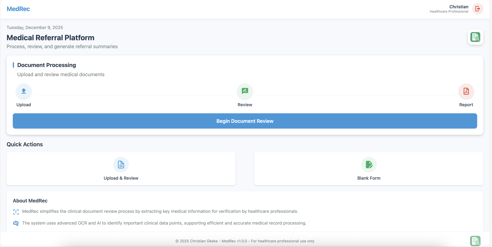
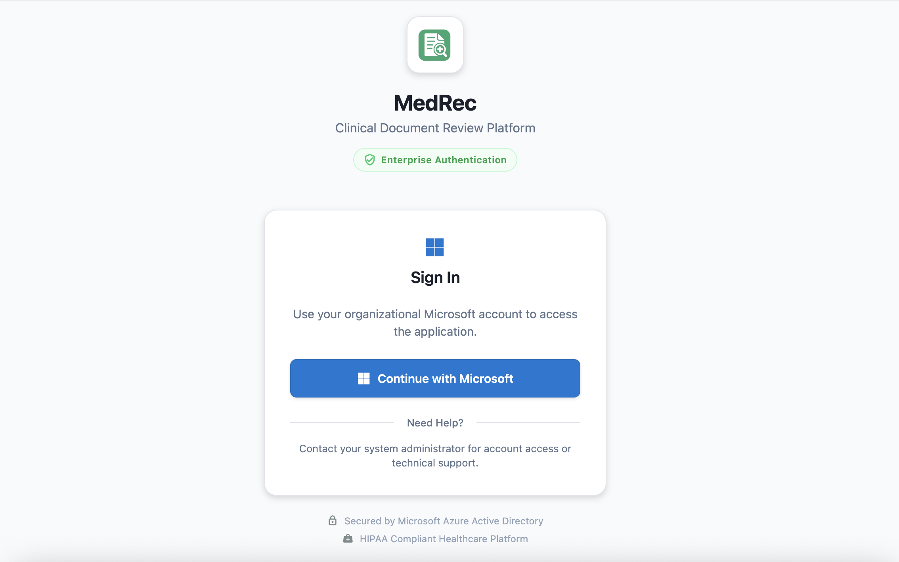

# MedRec

  
  &nbsp;&nbsp;&nbsp;&nbsp;
  

  <strong>Clinical Document Review Platform</strong> 
  HIPAA-compliant medical referral processing with AI-powered document extraction

  
  
  

---

## Overview

MedRec simplifies the clinical document review process by extracting key medical information for verification by healthcare professionals. The system uses advanced OCR and AI to identify important clinical data points, supporting efficient and accurate medical record processing.

---

## Features

- **Enterprise Authentication** - Secure Microsoft Azure AD integration
- **Document Processing** - Upload, review, and generate referral summaries
- **AI-Powered Extraction** - Automatic extraction of clinical data points
- **Parallel OCR** - Fast multi-page document processing with Tesseract.js
- **Cross-Platform** - Works on Web, iOS, and Android
- **HIPAA Compliant** - Secure healthcare data handling

---

## Tech Stack

- **Frontend**: React Native / React Native Web
- **Authentication**: Microsoft Azure Active Directory
- **OCR**: Tesseract.js with parallel processing
- **PDF Processing**: PDF.js
- **AI**: Embeddings for semantic search and document Q&A

---

## Request a Demo

This is a proprietary healthcare solution. For demo access or licensing inquiries:

  

---

## License

Proprietary - All rights reserved. Contact for licensing information.

---

  © 2025 Christian Okeke • MedRec v1.0.0 • For healthcare professional use only

